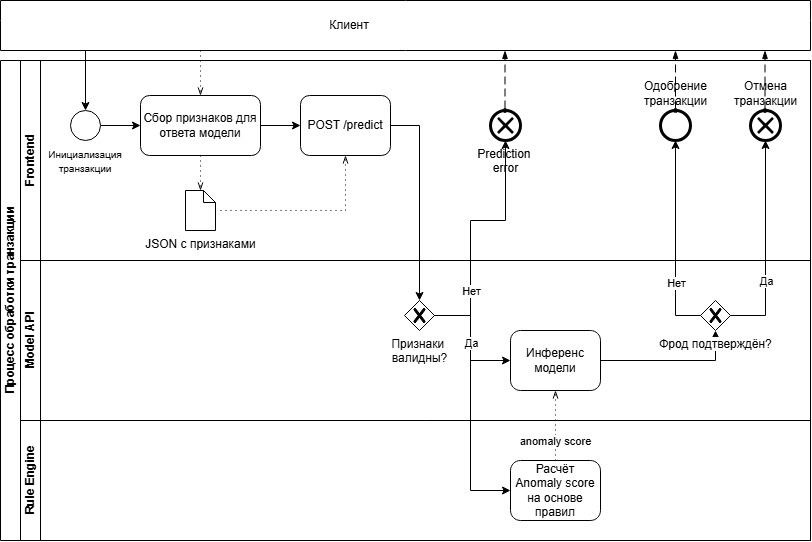

# BPMN-схема процесса скоринга банковских транзакций

## Модель 1. Бизнес-процесс: проведение и проверка банковской операции

**Место модели в бизнес- или техническом процессе проекта. BPMN-диаграмма:**:

### Краткое описание BPMN-схемы

#### 1. Какую задачу в процессе решает модель

ML-модель решает задачу **бинарной классификации транзакций** — определяет итоговый вердикт по операции: мошенническая (`fraud_flag = 1`) или легитимная (`fraud_flag = 0`), а также возвращает **вероятность фрода** (`probability`), которая используется для гибкого ранжирования риска.

Ключевая особенность процесса: **модель работает не изолированно, а поверх результатов правило-ориентированной антифрод-системы**. На вход модели подаётся не только сырые данные транзакции, но и оценка `anomaly_score` от статической системы правил. Модель принимает **окончательный вердикт**, заменяя бинарное решение «блок/разрешить» на вероятностную оценку.

#### 2. Почему для этой задачи целесообразно использовать ML

- **Высокий уровень ложных срабатываний (False Positive)** — статические правила блокируют легитимные транзакции, что ведёт к недовольству клиентов и росту нагрузки на поддержку. ML-модель снижает долю ложных блокировок за счёт вероятностной оценки риска вместо бинарных правил (целевой эффект — на 30% меньше ложных блокировок).
- **Низкая адаптивность к новым схемам мошенничества** — мошенники быстро обходят статические правила. ML-модель выявляет **сложные нелинейные паттерны**, которые невозможно описать правилами, и может регулярно переобучаться через CI/CD-пайплайн.
- **Невозможность учёта сложных нелинейных зависимостей** правилами — градиентный бустинг (LightGBM) улавливает взаимодействия между 18 признаками (сумма, гео, устройство, история), которые аналитик не опишет вручную.
- **Отсутствие вероятностной оценки риска** — бинарное решение «блок/разрешить» не позволяет ранжировать транзакции. ML возвращает `probability`, что даёт гибкое управление порогом и приоритизацию.
- **Ручная настройка и поддержка правил** — затраты времени аналитиков и задержки во внедрении улучшений. ML-модель настраивается через Optuna и переобучается автоматически.

Итоговые бизнес-цели: снижение финансовых потерь от мошенничества на 15–25%, снижение ложных блокировок на 30%, повышение гибкости системы.

#### 3. Какие данные поступают на вход модели

Модель принимает **вектор из 18 признаков**, сформированный каналом (front-end) и дополненный результатом работы правило-ориентированной системы:

**Количественные (13):**
- `transaction_amount` — сумма операции
- `anomaly_score` — **оценка аномальности от правило-ориентированной антифрод-системы** (ключевой признак, связывающий два контура)
- `account_age_days` — возраст аккаунта
- `login_attempts` — число попыток авторизации
- `transfer_frequency` — частота исходящих переводов
- `failed_transactions_last_30d` — отклонённые транзакции за 30 дней
- `avg_monthly_balance` — средний месячный остаток
- `daily_transaction_count` — среднее число операций в сутки
- `geo_distance_km` — расстояние между геолокациями
- `session_duration_minutes` — длительность сессии
- `transaction_velocity_score` — интенсивность транзакций
- `device_risk_score` — риск устройства (0–100)
- `transaction_time_hour` — час суток (0–23)

**Категориальные (2):**
- `payment_channel` — POS / веб-банк / мобильное приложение / банкомат
- `authentication_type` — OTP / биометрия / 2FA / пароль

**Бинарные флаги (3):**
- `card_present_flag` — использование физической карты
- `international_transaction_flag` — трансграничность
- `suspicious_ip_flag` — подозрительный IP

На вход API подаётся JSON с данными транзакции и параметром `threshold`. Ответ содержит `prediction`, `probability` и итоговый `decision`.

#### 4. Как результат работы модели используется дальше в процессе

1. **Автоматическое решение по порогу** :
   - `probability < threshold_low` → **разрешить транзакцию**;
   - `probability ≥ threshold_high` → **заблокировать и уведомить клиента**;
   - промежуточная зона — регулируется политикой банка (доп. аутентификация / отложенное проведение), без ручного разбора.
2. **Режим shadow mode (первые 2 недели).** Прогнозы логируются, но не влияют на решения — консервативный запуск для валидации на реальном трафике перед продакшеном.
3. **Обратная связь и переобучение.** Все прогнозы логируются в MLflow; фактические исходы (подтверждённый фрод / жалобы клиентов) формируют датасет для регулярного переобучения модели через Deploy Model Pipeline.
4. **Объяснимость для аудита.** Для регуляторных требований прогноз сопровождается SHAP/LIME-объяснением — какие признаки повлияли на решение (доступно службе комплаенс, не оператору).
5. **Мониторинг дрейфа.** Отслеживание data drift и деградации качества через MLflow; при выходе метрик за границы запускается переобучение.

---

## Модель 2. Технический пайплайн ML-модели

*(Схема без изменений относительно предыдущей версии — Data Processing Pipeline → Deploy Model Pipeline, с автоматическим переобучением по триггеру `models/*.pkl` или `workflow_dispatch`, валидацией данных через pytest и тестированием API в контейнере перед деплоем в продакшен.)*

**Ключевая связь двух моделей:** результат Deploy Model Pipeline (обученная LightGBM-модель в `.pkl` и Docker-образ в GHCR) является входом для Антифрод-сервиса (ML API) в бизнес-процессе Модели 1. 