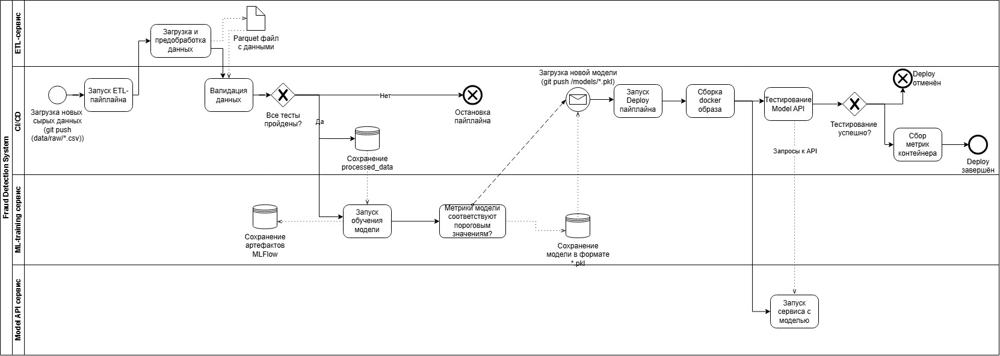

# Model Retrain BPMN — краткое описание процесса

**BPMN-диаграмма переобучения модели:**:

## 1. Триггер запуска переобучения модели
**Что происходит:** процесс запускается по одному из событий — поступление нового CSV в `data/raw/` и push в `main`, изменение `models/*.pkl`, либо ручной запуск `workflow_dispatch` в GitHub Actions.
**Результат:** активирован Data Processing Pipeline, зафиксирован факт необходимости переобучения.

## 2. Получение и подготовка новых данных
**Что происходит:** checkout кода, установка Python 3.10 и зависимостей, запуск `src.etl.etl.main()` (загрузка сырого CSV, удаление дубликатов, приведение `fraud_flag` к 0/1, заполнение пропусков, лог-признаки, индекс по `transaction_id`), валидация через `pytest tests/test_data_validate.py`, выгрузка артефакта `processed-data`.
**Результат:** валидированный Parquet-датасет в `data/processed/run_id={timestamp}/data.parquet`, переданный на обучение. При провале тестов — pipeline останавливается, артефакт не публикуется.

## 3. Обучение новой версии модели
**Что происходит:** checkout, Python 3.11, установка зависимостей, запуск `src.model_scripts.train.main()` — кодирование категориальных признаков, train/test split, подбор гиперпараметров через Optuna, обучение финальной модели LightGBM, логирование метрик и графиков в MLflow, регистрация в Model Registry, сохранение `.pkl`.
**Результат:** обученная модель `.pkl`, run_id, метрики и артефакты MLflow/Optuna DB, переданные на проверку качества.

## 4. Проверка качества модели
**Что происходит:** сравнение метрик новой версии с текущей production-версией (Recall, Precision, F1, AUC-ROC), проверка на деградацию и дрейф, анализ бизнес-критериев (снижение FP, сохранение Recall по фроду).
**Результат:** отчёт о качестве и вердикт `pass / fail`, переданный в шлюз принятия решения.

## 5. Принятие решения о возможности публикации новой версии
**Что происходит:** шлюз `Quality approved?` — сопоставление результатов проверки с пороговыми значениями и требованиями регуляторного аудита.
**Результат:** при `pass` — переход к регистрации и деплою; при `fail` — переход к ветке обработки неуспеха.

## 6. Регистрация или сохранение новой версии модели
**Что происходит:** фиксация модели в MLflow Model Registry с версией и метаданными, сохранение `.pkl` в `models/`, выгрузка MLflow/Optuna артефактов в GitHub Artifacts, получение имени файла и `run_id`.
**Результат:** версионированная модель, готовая к сборке Docker-образа.

## 7. Деплой модели
**Что происходит:** сборка Docker-образа (`python:3.10-slim`, FastAPI, модель, конфиг), теги `:latest` и `:{git_commit_sha}`, аутентификация в `ghcr.io`, push образа, локальный запуск контейнера `fraud-api`, прогон `pytest` (module + integration), сбор метрик контейнера, очистка.
**Результат:** опубликованный образ в GHCR и подтверждённо работоспособный сервис; при успехе — `Deploy to production` (End Event).

## 8. Действия при неуспешном прохождении проверок
**Что происходит:** срабатывает ветка `No` на шлюзах валидации данных, качества модели или API-тестов. Выполняется откат (rollback) к предыдущей стабильной версии, остановка и удаление контейнера, отправка алерта ответственным, логирование причины сбоя.
**Результат:** production остаётся на прежней версии, инцидент зафиксирован; процесс завершается событием `Deploy cancelled` / `Pipeline stopped & alert sent`.